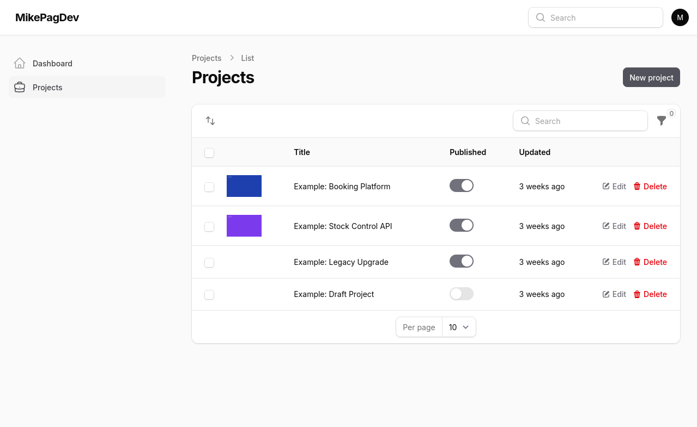
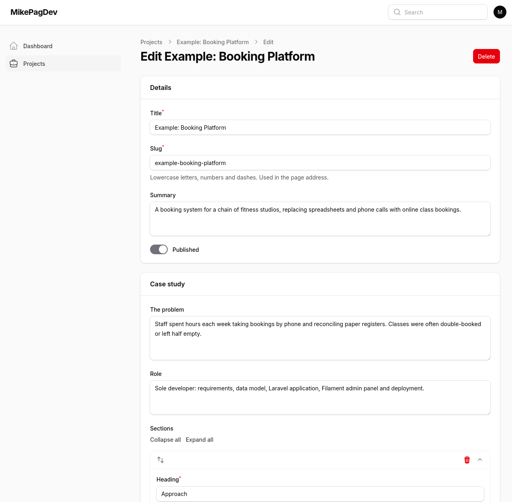

# Filament Portfolio

[](https://github.com/MikePageDev/filament-portfolio/actions/workflows/tests.yml)
[](https://packagist.org/packages/mikepagedev/filament-portfolio)
[](LICENSE.md)

Manage portfolio projects and case studies from a [Filament](https://filamentphp.com) panel.

This package is the admin side only. For public portfolio pages, add [portfolio-frontend](https://github.com/MikePageDev/portfolio-frontend), or read the `Project` model from your own code.





## Requirements

- PHP 8.5
- Laravel 13
- Filament 5.10 or newer, with a panel already set up

## Installation

Install the package:

```bash
composer require mikepagedev/filament-portfolio
```

Publish and run the migration, which creates the `portfolio_projects` table:

```bash
php artisan vendor:publish --tag=filament-portfolio-migrations
php artisan migrate
```

Screenshots are stored on the `public` disk by default, so link it if you haven't already:

```bash
php artisan storage:link
```

Then register the plugin in your panel provider:

```php
use MikePageDev\FilamentPortfolio\FilamentPortfolioPlugin;

public function panel(Panel $panel): Panel
{
    return $panel
        // ...
        ->plugin(FilamentPortfolioPlugin::make());
}
```

A **Projects** item now appears in your panel.

## What a project holds

| Field             | Notes                                                                 |
| ----------------- | --------------------------------------------------------------------- |
| Title             | Required.                                                             |
| Slug              | Generated from the title. Lowercase letters, numbers and hyphens.     |
| Summary           | Short description.                                                    |
| Problem           | The problem the project solved.                                       |
| Role              | The part you played.                                                  |
| Tech              | List of tags.                                                         |
| Case study        | Repeating sections, each with a heading and a body.                   |
| Screenshots       | Uploaded images, each with required alt text.                         |
| Live URL          | Link to the live project.                                             |
| Source URL        | Link to the source code.                                              |
| Published         | Drafts stay in the panel. Can be toggled from the table.              |
| Sort order        | Set by dragging rows in the table.                                    |

Screenshot files are deleted from disk when they are replaced or removed, and when a project is deleted.

## Configuration

Publishing the config file is optional:

```bash
php artisan vendor:publish --tag=filament-portfolio-config
```

| Key         | Default     | Description                                                                |
| ----------- | ----------- | -------------------------------------------------------------------------- |
| `disk`      | `public`    | Filesystem disk for screenshots. Set it with the `PORTFOLIO_DISK` env var. |
| `directory` | `portfolio` | Folder on that disk.                                                       |

## Using the model

```php
use MikePageDev\FilamentPortfolio\Models\Project;

$projects = Project::query()->published()->ordered()->get();
```

`published()` keeps only published projects, and `ordered()` sorts them by the table order. `Project::disk()` returns the filesystem disk the screenshots are stored on:

```php
$url = Project::disk()->url($project->images[0]['path']);
```

`tech`, `case_study` and `images` are cast to arrays. Each image has a `path` and an `alt`; each case-study section has a `heading` and a `body`.

There's a factory for your tests:

```php
Project::factory()->published()->create(['title' => 'Demo App']);
```

## Testing

```bash
composer check
```

This runs the tests (`composer test`), static analysis (`composer stan`) and the code style check (`composer lint`).

## Changelog

See [CHANGELOG.md](CHANGELOG.md).

## Credits

Built by [Mike Page](https://mikepage.dev). Part of a family of Filament packages; [portfolio-frontend](https://github.com/MikePageDev/portfolio-frontend) adds the public pages.

## License

MIT. See [LICENSE.md](LICENSE.md).
